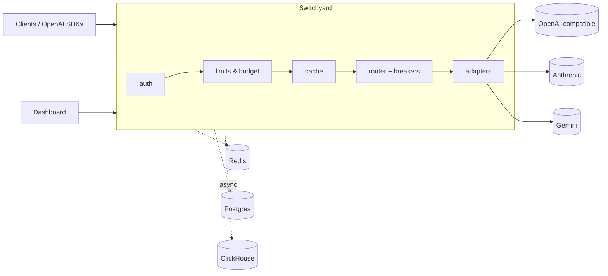

# Switchyard

**A high-performance LLM gateway written in Go.** One OpenAI-compatible endpoint in front of many model providers — with streaming pass-through, automatic fallback, circuit breakers, per-key rate limits and budgets, response caching, and real-time cost/latency analytics in ClickHouse.

Point any OpenAI SDK at Switchyard and change nothing else:

```python
from openai import OpenAI

client = OpenAI(base_url="http://localhost:8787/v1", api_key="sy-…")  # a Switchyard key
client.chat.completions.create(model="fast", messages=[{"role": "user", "content": "Hello"}])
```

`fast` is an alias you define — for example "OpenAI first, fall back to Anthropic" — and Switchyard handles the rest.


## Highlights

| | |
|---|---|
| **Gateway overhead** | p99 **≤ 0.13 ms** self-measured at every tested rate up to 7,500 rps (auth + routing + ClickHouse logging), measured from request arrival — see [BENCHMARKS.md](BENCHMARKS.md) |
| **Streaming** | 7,500 streaming rps × 20 tokens (150k SSE events/s) on one laptop with zero errors |
| **Resilience** | With a primary failing 30% of requests: **100%** client success; with the primary fully down: **100%**, breaker opens after ~20 requests |
| **Outage tolerance** | ClickHouse stopped at 5k rps: 0 failed requests. Redis stopped: limits fail open, requests succeed |
| **Analytics** | 24-hour overview over 1M logged requests in ~15 ms (1-minute rollup) |
| **Cache** | Cache hits served in 0.19 ms p50 at 5k rps |

## Features

- **OpenAI-compatible API** — `/v1/chat/completions` (streaming and non-streaming) and `/v1/models`; unknown fields pass through untouched.
- **Providers** — any OpenAI-compatible API (OpenAI, OpenRouter, Groq, Together…), plus native **Anthropic** and **Gemini** adapters that translate requests, responses and streams.
- **Routing** — model aliases with `priority` or `weighted` targets, retries with capped exponential backoff and jitter, first-byte timeout for streams, fallback only before the first byte reaches the client.
- **Circuit breakers** — per target, tripping on the failure rate over requests started in a sliding window.
- **API keys** — SHA-256-hashed keys in Postgres, allowed-model lists, an in-memory LRU so Postgres stays off the hot path, `switchyard keys` CLI.
- **Rate limits and budgets** — per-key requests/minute and tokens/minute (atomic Lua token buckets) and monthly USD budgets, with OpenAI-style `x-ratelimit-*` and `Retry-After` headers. One Redis round trip per request; fails open.
- **Response cache** — exact-match, per-project, deterministic requests only; streaming answers are cached and replayed as streams.
- **Analytics** — every request logged to ClickHouse asynchronously (latency, TTFT, upstream time, gateway overhead, tokens, cost, cache, attempts), 1-minute rollups, admin API with keyset pagination, WebSocket live tail.
- **Dashboard** — Next.js app: overview, request explorer, live tail, key management, target health.
- **Observability** — Prometheus `/metrics`, OpenTelemetry tracing (joins the caller's `traceparent`), pprof on an opt-in debug port.
- **Packaging** — 41.7 MB distroless non-root image, Docker Compose profiles, graceful shutdown that lets in-flight streams finish.

## Architecture



Request lifecycle, failure policy and design decisions: [docs/architecture.md](docs/architecture.md).

## Quickstart

Requirements: Go 1.26, Docker, Node 22 (for the dashboard).

```sh
cp .env.example .env            # set SWITCHYARD_ADMIN_TOKEN; provider keys optional
make up                         # Redis, Postgres, ClickHouse (Docker)
make mock &                     # fake OpenAI-compatible upstream on :9797
make run                        # gateway on :8787 (loads .env)

go run ./cmd/switchyard keys create --project demo --name local   # prints a sy-… key once
curl localhost:8787/v1/chat/completions -H "Authorization: Bearer sy-…" \
  -d '{"model":"mock-fast","messages":[{"role":"user","content":"hi"}]}'

cd web && npm install && npm run dev   # dashboard on http://localhost:3100
```

**Demo mode (no backend).** `NEXT_PUBLIC_DEMO=1 npm run build` produces a dashboard that serves admin-API responses recorded from a real gateway (`web/public/demo`, captured with `web/scripts/capture-demo.mjs` against `deploy/switchyard.demo.yaml`, which routes to simulated upstreams) and replays the live tail — suitable for free static hosting.

Everything in containers instead: `docker compose -f deploy/docker-compose.yml --profile full up -d --build`.
Tracing UI: `docker compose -f deploy/docker-compose.yml --profile tracing up -d jaeger`, set `tracing.enabled: true`, open http://localhost:16686.

To use real providers, uncomment them in [`deploy/switchyard.example.yaml`](deploy/switchyard.example.yaml) and add the API keys to `.env`.

## Configuration

A single YAML file ([example](deploy/switchyard.example.yaml)), validated at startup with clear errors:

```yaml
models:
  - alias: fast
    strategy: priority                 # or weighted
    targets:
      - { provider: openai,    model: gpt-4o-mini }
      - { provider: anthropic, model: claude-haiku-4-5 }
routing:
  max_attempts: 3
  retry_on: [429, 500, 502, 503, 504, 529, timeout, connect_error]
  first_byte_timeout: 20s
breaker: { failure_rate: 0.5, min_requests: 20, window: 10s, open_duration: 30s }
cache:   { enabled: true, ttl: 10m, only_when_temperature_zero: true }
```

## Benchmarks

Final v0.1.0 run on an Apple M4 (10 cores), with the load generator, a zero-latency mock upstream and the gateway on the same machine. Full method, raw runs and caveats: [BENCHMARKS.md](BENCHMARKS.md).

| Scenario @ 5,000 rps | Gateway self-measured overhead p50 / p99 | Client-observed added p50 / p99 |
|---|---|---|
| Proxy + auth + routing + ClickHouse logging, non-stream | 0.005 / 0.027 ms | +0.04 / +0.22 ms |
| Same, streaming (20 tokens) | 0.007 / 0.054 ms | +0.05 / +0.57 ms |
| + Redis rate limits & budgets (Redis in Docker Desktop) | 0.151 / 1.107 ms | +0.23 / +0.86 ms |

Reproduce: `./bench/run.sh`, `./bench/chaos.sh`.

## Engineering notes

Two findings from profiling and chaos testing that shaped the design (details in [docs/architecture.md](docs/architecture.md)):

1. **Per-event flushing dominated CPU.** Coalescing SSE flushes — without ever delaying an event — cut CPU 56% and p99 overhead from +80 ms to single-digit ms at 5k streaming rps.
2. **"N consecutive failures" breakers trip healthy targets under concurrency.** Fast failures complete before slow successes. Switchyard's breaker compares failures with requests *started* in a sliding window instead.

## Project layout

```
cmd/switchyard   gateway + `keys` CLI        internal/server     HTTP, chat pipeline
cmd/mockllm      fake upstream               internal/router     plans, retries, breakers
cmd/loadgen      open-model load generator   internal/provider   OpenAI, Anthropic, Gemini adapters
cmd/benchreport  benchmark report            internal/ratelimit  Redis token buckets + budgets
cmd/seedlogs     synthetic analytics data    internal/cache      response cache
web/             Next.js dashboard           internal/logsink    ClickHouse batch writer
bench/           benchmark + chaos scripts   internal/admin      admin API + live tail
deploy/          Dockerfile, compose, config migrations/         Postgres + ClickHouse DDL
```

## Development

```sh
make lint test build                       # gofmt, vet, staticcheck, race tests
go test -tags integration ./...            # against the compose services
go test -fuzz=FuzzReader ./internal/sse    # SSE parser fuzzing
```

## Roadmap

- Request coalescing for cache misses (stampede protection — measured in [BENCHMARKS.md](BENCHMARKS.md#phase-7--response-cache))
- Tool/function calling for the Anthropic and Gemini adapters
- Semantic (embedding) cache
- Propagating trace context to upstream providers
- Kubernetes manifests and horizontal-scaling benchmarks

## License

MIT
