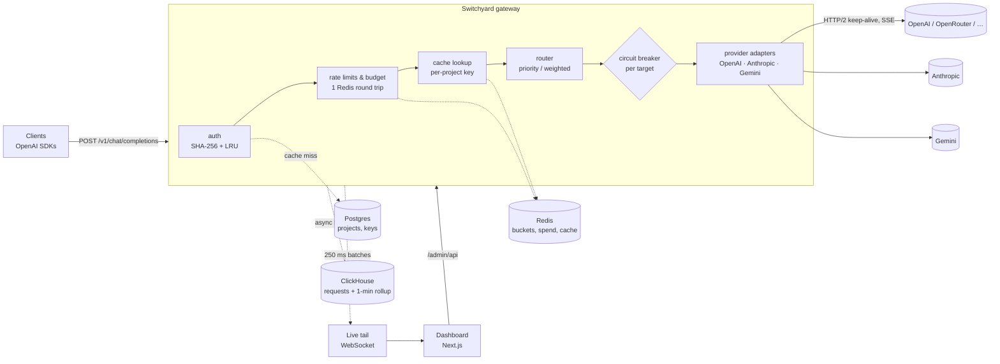

# Architecture

Switchyard is a single Go binary that sits between applications and LLM providers. Clients speak the OpenAI Chat Completions API; Switchyard authenticates, rate-limits, routes, retries, caches, streams and records every request.



## Request lifecycle

```mermaid
sequenceDiagram
    autonumber
    participant C as Client
    participant G as Switchyard
    participant R as Redis
    participant U as Upstream A
    participant V as Upstream B
    participant CH as ClickHouse

    C->>G: POST /v1/chat/completions (stream)
    G->>G: authenticate (in-memory LRU; Postgres only on miss)
    G->>R: EVALSHA rpm + EVALSHA tpm + GET spend (one pipeline)
    G->>R: GET cache:{project,request} (temperature 0 only)
    G->>U: attempt 1 (first-byte timeout armed)
    U-->>G: 503
    G->>G: breaker.Failure(A); backoff with jitter
    G->>V: attempt 2
    V-->>G: first chunk
    G-->>C: 200 + SSE (headers now committed — no more fallback)
    loop each chunk
        V-->>G: chunk
        G-->>C: chunk (flush only if no complete chunk is already buffered)
    end
    G-->>C: data: [DONE]
    G--)R: settle TPM + spend (async)
    G--)R: store cache entry (async)
    G--)CH: enqueue log record (non-blocking)
```

## Failure policy

Nothing on the request path waits on the analytics system, and every optional dependency fails open.

| Dependency down | Behaviour | Signal |
|---|---|---|
| Redis | Rate limits and budgets are not enforced, cache is bypassed; requests succeed | `switchyard_dependency_errors_total{dep="redis"}`, one warning per 10 s |
| Postgres | Keys already in the 30 s LRU keep working; unknown keys get `503 auth_unavailable` | log + 503s |
| ClickHouse | Records queue (bounded), then are dropped and counted; requests unaffected | `switchyard_logs_dropped_total` |
| One provider target | Retry on another target before the first byte; breaker opens on ≥50% failures over ≥20 started requests in 10 s | `switchyard_breaker_state`, `switchyard_upstream_errors_total` |
| Every target for a model | `503 no_healthy_target` immediately (no waiting) | breaker gauges |
| Upstream fails mid-stream | Error event sent in-band, then `[DONE]` — headers are already sent, so no fallback | `switchyard_upstream_errors_total` |

## Design decisions

**Flush coalescing.** Flushing every SSE event was 57% of CPU at 5k streaming rps. The gateway now flushes only when the next *complete* event isn't already in the upstream read buffer — bursts leave in one write, a lone event is never delayed. A partial next event still triggers a flush; otherwise, with real providers (10–30 ms between tokens), a token would wait for the next TCP packet. The SSE reader owns its buffer so this check is exact. Result: −56% CPU, p99 overhead from +80 ms to single-digit ms. See [BENCHMARKS.md](../BENCHMARKS.md#optimization-log).

**Breaker counts started requests.** "N consecutive failures" tripped a target that failed only 30% of the time, because under concurrency fast failures complete before slow successes. A failure *rate over completed requests* had the same bias at startup. The breaker therefore compares failures with requests *started* in a sliding window, which is independent of completion order.

**One Redis round trip.** RPM bucket, TPM bucket and budget are checked in a single pipeline; the token bucket is a Lua script using Redis `TIME` so gateway clocks don't matter. Reconciliation of actual token usage and spend happens asynchronously after the response.

**Per-project cache keys.** The cache key is `sha256(project ‖ canonical request JSON)`, so two tenants never share cached answers, and field order or `stream`/`user` flags don't fragment the cache. Only `temperature: 0` requests are cached; tool calls and `n > 1` are not.

**Analytics off the hot path.** Records go into a bounded channel with a non-blocking send and are written in batches with the ClickHouse native protocol. Long ranges are served from a 1-minute `AggregatingMergeTree` rollup fed by a materialized view (24 h over 1M rows: ~15 ms). The request log uses keyset pagination on `(ts, request_id)`.

**Measure from arrival.** Gateway overhead is measured from the moment the request arrives (before auth) minus time spent waiting on upstreams and backoff, and exported as a histogram; benchmarks report both this and client-observed latency against a direct baseline.

## Technology choices

| Choice | Why |
|---|---|
| Go + `net/http` | Predictable latency, cheap goroutine-per-stream concurrency, first-class HTTP/2 and profiling; no framework needed with Go 1.22+ routing |
| Redis | Atomic Lua token buckets and counters shared by every gateway instance |
| Postgres | Durable, relational metadata (projects, keys) with migrations; off the hot path thanks to the LRU |
| ClickHouse | Columnar analytics: millions of rows per second ingest, sub-100 ms aggregations, TTL and rollups built in |
| OpenTelemetry | Vendor-neutral tracing; joins the caller's trace via W3C `traceparent` |
| Next.js dashboard | Typed client for the admin API, SWR caching, WebSocket live tail |
