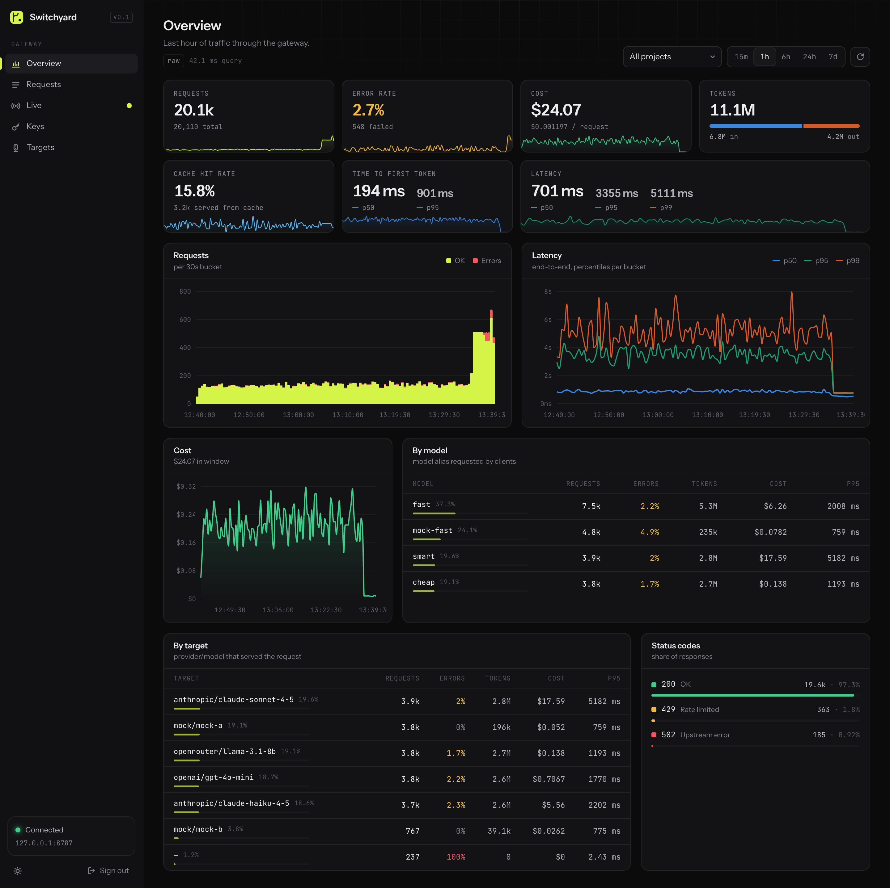

# Switchyard dashboard

The admin dashboard for the Switchyard gateway. It's built with Next.js 15 (App Router), TypeScript, Tailwind CSS v4, Recharts and SWR.

It talks to the gateway's admin API (`/admin/api/*`) and live tail WebSocket (`/admin/live`) **directly from the browser**. It has no server-side code of its own, so `next build` produces a static client app.



## Pages

| Page | What it shows |
|---|---|
| **Overview** (`/`) | KPI tiles (requests, error rate, cost, tokens in/out, cache hit rate, latency p50/p95/p99, TTFT p50/p95), charts for requests (ok vs errors, stacked), latency percentiles and cost, plus breakdowns by model, by target and by status code. It has a global time range (15m · 1h · 6h · 24h · 7d) and a project filter. The data source (`raw` vs `rollup · 1m`) and the ClickHouse query time are shown under the title. |
| **Requests** (`/requests`) | The request log, with filters for model, status (ok / error / exact code) and key, plus the time range. It uses keyset pagination ("Load more" follows `next_cursor`). Clicking a row (or pressing Enter on it) opens a drawer with timings (latency, TTFT, upstream, gateway overhead µs), tokens, cost, routing, cache and error code. |
| **Live** (`/live`) | A WebSocket tail, newest first, capped at 500 rows. You can pause and resume it (<kbd>space</kbd>) and filter by model and status. It shows a req/s indicator with a 60-second sparkline and the server-reported `skipped` count, and it reconnects automatically with jittered exponential backoff. |
| **Keys** (`/keys`) | Lists each key with its prefix, project, allowed models, RPM/TPM limits, monthly budget with a spend bar and last-used time. **Create** shows the secret exactly once, with a copy button. **Edit** sends a minimal PATCH and uses the `clear_*` flags to remove limits. Each row has an enable/disable switch. |
| **Targets** (`/targets`) | Circuit-breaker state for each upstream target (closed = green, half-open = amber, open = red), with 15-minute requests, error rate and p95. Refreshes every 5s. |

Every view has loading skeletons, empty states and error states. A `401` sends you back to sign-in. A `503` (ClickHouse/Postgres not configured) shows an explanatory empty state instead of an error.

Keyboard: <kbd>g</kbd> then <kbd>1</kbd>–<kbd>5</kbd> jumps between pages. Every control is reachable by Tab, and drawers and dialogs are native `<dialog>` elements, so they trap focus and close on <kbd>Esc</kbd>. A light theme is available from the sidebar; dark is the default.

## Running it

Prerequisites: Node 20+ and a running gateway (see the repo root README).

```bash
cd web
npm install
npm run dev          # http://localhost:3100  (next dev -p 3100)
```

Open http://localhost:3100 and paste the gateway's admin token (`SWITCHYARD_ADMIN_TOKEN`). The dashboard checks it by calling `/admin/api/targets`, then keeps it in `sessionStorage`, so it's cleared on sign-out or when you close the tab.

### Configuration

| Variable | Default | Purpose |
|---|---|---|
| `NEXT_PUBLIC_SWITCHYARD_URL` | `http://127.0.0.1:8787` | Base URL of the gateway (admin API and WebSocket). It's inlined at build time. |

The gateway must allow the dashboard's origin in `admin.cors_origins` in `switchyard.yaml`. The default allows `http://localhost:3100` and `http://127.0.0.1:3100`.

### Full local demo with data

```bash
# from the repo root: services (Redis/Postgres/ClickHouse) must be up
make build
./bin/mockllm -ttft 50ms -itl 5ms -tokens 20 &
./bin/switchyard -config deploy/switchyard.example.yaml &      # loads .env
go run ./cmd/seedlogs -rows 200000 -span 1h                     # optional: synthetic history
./bin/switchyard keys create --project demo --name dash         # prints sy-… once
./bin/loadgen -key sy-… -model mock-fast -rps 50 -duration 60s -warmup 0s   # live traffic
```

## Scripts

| Command | |
|---|---|
| `npm run dev` | Dev server on port 3100 |
| `npm run build` / `npm start` | Production build, then serve it on port 3100 |
| `npm run lint` | ESLint (`next/core-web-vitals` + `next/typescript`), zero warnings allowed |
| `npm run typecheck` | `tsc --noEmit` (strict, `noUncheckedIndexedAccess`) |
| `npm test` | Vitest unit tests for the API client, formatters, range/bucket helpers, key-form diffing and the live list merge |

## Layout

```
app/                 routes (thin server components that set metadata and render a view)
components/views/    one client component per page
components/          shell/sidebar, sign-in, charts, overlays (sheet/modal), UI primitives
lib/api.ts           typed client; the types mirror internal/admin and internal/live JSON
lib/hooks.ts         SWR hooks (overview, timeseries, breakdown, request log, keys, targets)
lib/live.ts          WebSocket tail hook (batching, pause buffer, rate, backoff)
lib/format.ts        number/time formatters (ms, µs, $, %, compact counts)
lib/range.ts         time-range presets and gap filling for timeseries buckets
lib/keys.ts          key create/edit form parsing, validation and PATCH diffing
```

Notes:

- Fonts (Instrument Sans, Instrument Serif, JetBrains Mono) are bundled through `@fontsource`, so builds don't need network access.
- The timeseries endpoint returns only buckets that contain rows. The dashboard fills the gaps so bars line up with time and lines break across idle periods instead of interpolating.
- The Requests page snapshots its time window when the range changes, so "Load more" pages a stable set. Use the refresh button to move the window forward.
- The latency series colors (blue/green/orange) were checked for colour-blind separation against both theme surfaces.
